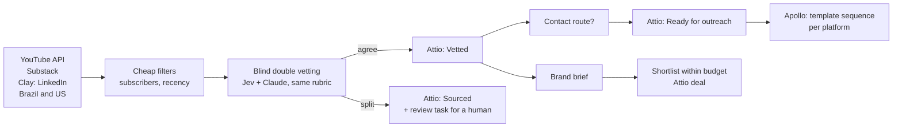

# Creator Supply Engine BR

Finds, vets and organizes B2B creators in Brazil and the US for a creator marketplace, built as a case study for the Creator Acquisition Analyst role at [Passionfroot](https://www.passionfroot.me).

**Case page (with results, screenshots and the playbook):** https://michelsoares.vercel.app/creators.html?lang=en

This repository holds the code behind it: the sourcing and vetting scripts, and the generator for the three n8n workflows.

## What it does



- **Stage A, brief → shortlist (workflow 1):** a brand brief comes in, Apollo enriches the company, Claude extracts the criteria, and Claude and Jev score up to 400 approved creators against the brief, blind. The shortlist fills the budget minus 10% and lands in Attio as a deal with its rationale.
- **Stage B, weekly supply (workflow 3):** every Monday, alternating Brazil and the US, it counts approved creators per category in Attio, searches YouTube and Substack in that market's three thinnest categories, and vets every new creator twice. Agreements go to Vetted; splits become an Attio task for a human.
- **Stage B, outreach (workflow 2):** when a creator reaches "Ready for outreach", Apollo gets the contact and the template sequence for their platform. Demo only: never activated.

## Vetting

Two evaluators, the same rubric, no peeking: [Jev](https://typesafe.ai/) (TypeSafe) and Claude score each creator independently, and code compares them.

- **Gates:** posts in the market's language (Portuguese for Brazil, English for the US), is a person (not a company, school or outlet), posted in the last 30 days, no red flags (betting, get-rich-quick, speculative trading, party politics).
- **Fit for B2B brands**, 1 to 5: would a B2B brand pay to reach this audience? From entertainment (1) to people who decide on buying software and services (5). B2B means fit ≥ 3.5.
- **Weights:** fit 30, quality 20, engagement 15 and consistency 15 (computed), sponsorship readiness 10, regional fit 10. Cutoff: 60.
- **Split verdict** when the verdicts differ, a gate disagrees, or fit or quality differ by 2+ points. A human decides those.
- **Price guardrail (YouTube):** a robust z-score of views per subscriber within Passionfroot's price bands moves the rate up or down, with a CPM ceiling and a floor.

## Layout

| Path | What's in it |
|---|---|
| `scripts/rubric.mjs` | Rubrics, categories, Jev questions, the comparison rules |
| `scripts/youtube_sourcing.mjs`, `substack_sourcing.mjs`, `clay_export_runs.mjs` | Sourcing from YouTube, Substack and Clay |
| `scripts/jev_vetting.mjs`, `amostra_claude.mjs`, `compare_vetting.mjs`, `linkedin_vetting.mjs`, `newsletter_vetting.mjs` | Double vetting per platform |
| `scripts/guardrail.mjs`, `jev_brief.mjs`, `shortlist.mjs` | Price guardrail and brief shortlist (stage 1 of the case) |
| `scripts/attio_*.mjs` | Attio client, schema setup and sync |
| `scripts/apollo_setup.mjs`, `apollo_contatos.mjs` | Apollo custom fields and the inactive template sequences |
| `scripts/n8n_workflows.mjs` | Generates the three n8n workflows |
| `scripts/n8n_check.cjs`, `n8n_test_w3.mjs` | Static check and a local runner for workflow 3 |
| `scripts/case_snapshot.mjs`, `case_figures.mjs`, `gap_map.mjs`, `check_english.cjs` | Read-only snapshot and the figures on the case page |
| `n8n/` | The three workflows as JSON, ready for Workflows → Import from file |

## Running it

Node 22, no dependencies. Create a `.env` from `.env.example` and a `data/` folder next to `scripts/`, then for example:

```sh
node scripts/youtube_sourcing.mjs batch1 "gestão de produto" "marketing B2B"
node scripts/jev_vetting.mjs batch1
node scripts/compare_vetting.mjs batch1
```

In n8n, the workflows expect Header Auth credentials named Attio, Apollo, Anthropic, Jev and YouTube.

## Notes

- **No data is included.** The `data/` folder (creator lists, vetting results, contacts) stays private under Brazil's data protection law (LGPD). For the same reason, `n8n_workflows.mjs` needs that folder to rebuild workflow 3's list of creators already seen; the generated JSONs are included as they are.
- **No creator was contacted.** The Apollo sequences are templates marked "[TEMPLATE — do not send]", inactive, with no contacts and no mailbox, and workflow 2 was never activated.
- **Comments and some names are in Portuguese.** It started as a Brazilian project; the rubric and Jev's questions stay in Portuguese for both markets, with the language gate and regional fit set by the market (`MERCADO=BR|US`, or a batch name starting with `us`). Everything a brand or recruiter sees (n8n nodes, Attio, Apollo, the case page) is in English.
- The ElevenLabs brief used in stage A is hypothetical. This is an independent project, not affiliated with Passionfroot or ElevenLabs.
